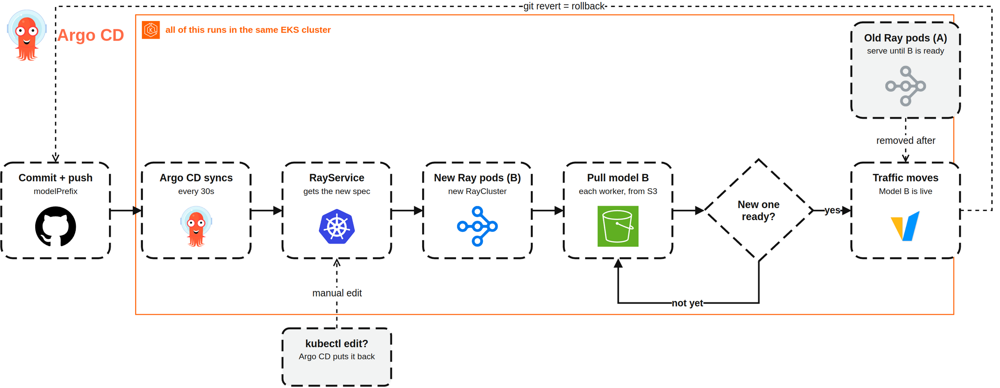
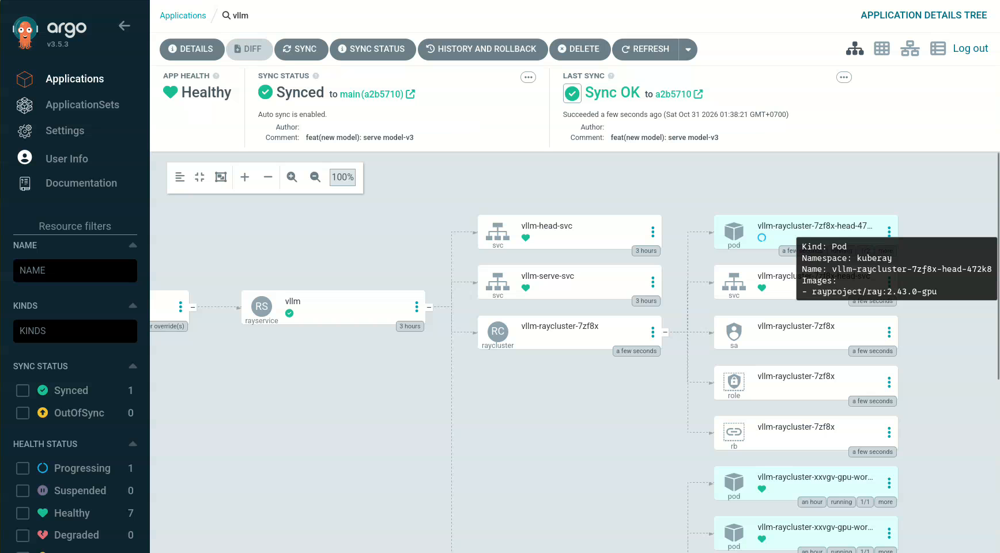
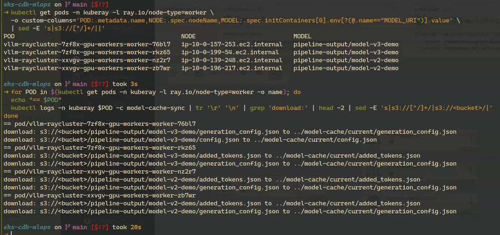
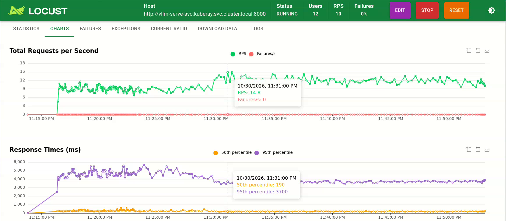

# LLM on EKS: Rolling Out New Models with GitOps & Argo CD

Hi there! 👋🏽 In the [previous post](../pipeline_llm/README.md), a Kubeflow pipeline fine-tuned `Qwen2.5-1.5B-Instruct` with LoRA, quantized it with AWQ, and pushed it to S3. But our serving stack didn't use that model at all. vLLM was serving a Llama model from Hugging Face.

So in this post, we'll close that gap. vLLM loads the pipeline's model from S3, every model version gets its own S3 prefix, and switching versions is a Git commit. Argo CD picks up the commit, and KubeRay brings up the new model next to the old one before moving traffic over.

On top of that, we put a small chatbot: an assistant for AWS Community Day Jakarta 2026 that answers questions about the agenda from a knowledge base in its prompt. It's our way to try the model, and later to load test it.

## TL;DR

- Each GPU worker pulls the model from S3 in an init container before vLLM starts. 1.6 GB synced in about 6 seconds through the S3 Gateway Endpoint.
- vLLM serves it under a stable name, `qwen-lora`, so clients don't change when the model behind it does.
- Model versions are write-once S3 prefixes (`pipeline-output/model-v1`, `pipeline-output/<run-id>`). `modelPrefix` in `manifests/vllm/values.yaml` picks which one gets served.
- Switching models is a Git commit. Argo CD synced ours 25 seconds after the commit, KubeRay builds a new RayCluster with the new model, and traffic moves once it serves. The whole switch takes 10 to 15 minutes. Rolling back is `git revert`.
- A switch needs room for two clusters for a few minutes: twice the GPUs, plus a second Ray head on the system nodes.
- vLLM is reachable from inside the cluster, no public load balancer in front of the GPU.
- A new GPU replica takes about 8 minutes from request to serving, and Karpenter accounts for less than one of them.

## Architecture

Here's how the pieces fit together. A developer deploys the infra with CDK and runs the Kubeflow pipeline, which writes each model to its own S3 prefix. A commit to `manifests/vllm/values.yaml` tells Argo CD which model to serve, and KubeRay rolls it out to the GPU workers that Karpenter brings up. Users talk to the event chatbot, which calls vLLM inside the cluster.


> Click the image to zoom in.

## Serving the Model from S3

In the serving post, vLLM downloaded the model from Hugging Face on first boot. Now the model comes from our own S3 bucket. Each GPU worker in the RayService has an init container that copies it before the Ray worker starts:

```yaml
initContainers:
  - name: model-cache-sync
    image: amazon/aws-cli:2.17.62
    command: ["sh", "-c", "aws s3 sync \"$MODEL_URI\" /model-cache/current"]
```

`MODEL_URI` is `s3://<bucket>/<modelPrefix>`. The files land in an `emptyDir` mounted at `/model-cache`, the Ray worker mounts the same volume, and vLLM loads the model from `/model-cache/current`.

Why a copy per pod instead of shared storage like EFS or Mountpoint for S3? The model is 1.6 GB and the copy takes about 6 seconds, so there isn't much to win. And a worker from a scale-out gets the model the same way, because `MODEL_URI` is part of the worker spec.

The path on disk is `/model-cache/current` for every version, and vLLM serves it as `qwen-lora` (`served_model_name` in the Serve config). [`serve_vllm.py`](https://github.com/danielcristho/eks-cdk-llm/blob/main/hypertuning_llm/hypertuning_llm/vllm/serve_vllm.py) passes that name to the engine and to `/v1/models`, so clients ask for `qwen-lora` no matter which model is behind it.

### The IMDS Hop Limit

The first time the init container ran, `aws s3 sync` failed to find credentials. The pod gets AWS access from the node's IAM role, through the instance metadata service (IMDS). Karpenter launches nodes with IMDSv2 and a hop limit of 1. A pod sits one network hop behind the node, so the token response doesn't reach it. The fix is one line in the GPU `EC2NodeClass`:

```python
# Karpenter's default hop limit of 1 blocks pods from IMDS, so they can't use the node role for S3
"metadataOptions": {"httpTokens": "required", "httpPutResponseHopLimit": 2},
```

After that, the sync pulled 9 files (1.6 GB) in 6 seconds. A role per service account (IRSA or EKS Pod Identity) is the stricter option, but the node role is enough for a bucket the GPU nodes read anyway.

## Versioning the Model

Every model gets its own S3 prefix, and we write each prefix once. The problem with the previous post was `pipeline-output/latest`: every `pipeline_llm` run overwrites it, so the name stays the same while the model behind it changes. I copied that model to `pipeline-output/model-v1`. From the next post on, every pipeline run writes to its own `pipeline-output/<run-id>`, and a run ID is unique.

Which version gets served lives in Git, in the vLLM chart's `manifests/vllm/values.yaml`:

```yaml
modelPrefix: pipeline-output/model-v1
```

So if you want to know which model is running, look at Git. If you want to change it, commit. The S3 bucket name stays out of the repo: CDK reads it from `.env` and passes it to the chart.

With `latest`, Git would say the same thing the whole time while the files behind it change with every run. You couldn't tell which model served yesterday, and `git revert` would have nothing to go back to.

The other chart values (bucket, region, Ray and vLLM versions, `max_model_len`) are account or setup specific, so they come from `.env`. CDK passes them to Argo CD as Helm parameters, and the chart refuses to render if one is missing. Git holds the model version, `.env` holds the rest.

One more guard: `just deploy` refuses to run with uncommitted changes in the folder. CDK deploys what's on your disk, Argo CD deploys what's on GitHub. When the two differ, you end up debugging a cluster that matches neither.

## Rolling Out Model B

Model A is what's serving now: `pipeline-output/model-v1`. Model B is any newer version.

Switching from A to B starts with a commit. We set Argo CD to check Git every 30 seconds, so it picks up the commit and updates the RayService. KubeRay builds new Ray pods next to the old ones, and each new worker pulls model B from S3. The old pods keep serving until the new ones are ready, then traffic moves over and the old pods go away. To roll back, `git revert` the commit. And if someone edits the RayService by hand, Argo CD puts it back to what Git says.



> Click the image to zoom in.

### Why the Model Lives in `rayClusterConfig`

A RayService has two parts, and where the model path sits decides how KubeRay rolls it out:

- A change in `serveConfigV2` (the Ray Serve app) restarts the app in place, on the same cluster. While vLLM reloads, no replica answers.
- A change in `rayClusterConfig` (the pods) makes KubeRay build a whole new RayCluster next to the old one, and move traffic when the new one serves.

`MODEL_URI` is an env var of the worker pods, so it's in `rayClusterConfig`, and a new model gets the second path. KubeRay's Service `vllm-serve-svc` points at whichever cluster is active, so clients don't notice the switch. And `min_replicas: 1` makes the new cluster load a replica right away instead of waiting for traffic.

### The Argo CD Application

CDK installs Argo CD on the system nodes and creates one Application, `vllm`, that watches the chart folder:

```python
"source": {
    "repoURL": repo_url,             # GITOPS_REPO_URL
    "targetRevision": revision,      # GITOPS_REVISION
    "path": "hypertuning_llm/manifests/vllm",
    "helm": {"parameters": [...]},   # bucket, region, versions from .env
},
"syncPolicy": {"automated": {"prune": True, "selfHeal": True}},
```

- `selfHeal` puts back anything changed in the cluster that doesn't match Git.
- The Application has Argo CD's resources finalizer. Deleting it deletes the RayService too, so a cleanup doesn't leave GPU nodes behind.
- We dropped Argo CD's reconciliation timeout from the default 120s (plus up to 60s jitter) to 30s, so a demo doesn't sit there for 3 minutes.

The full stack is in [`argocd_stack.py`](https://github.com/danielcristho/eks-cdk-llm/blob/main/hypertuning_llm/hypertuning_llm/argocd/argocd_stack.py).

### Switching in Practice

```bash
sed -i 's|^modelPrefix:.*|modelPrefix: pipeline-output/model-v3-demo|' manifests/vllm/values.yaml
git add manifests/vllm/values.yaml
git commit -m "feat(new model): serve model-v3"
git push
```

We tested this on the cluster we used for the AWS Community Day talk (`survive_llm`, same chart, with one warm replica per AZ, so 2 GPU workers). `model-v2-demo` and `model-v3-demo` are copies of `model-v1` under new prefixes. The weights are the same, the path is what changes, and that's enough to watch the mechanism.

Switching from `model-v2-demo` to `model-v3-demo`:

| Stage | Time (UTC) | Since commit |
|---|---|---|
| Commit | 18:37:56 | |
| Argo CD synced | 18:38:21 | 25s |
| New Ray head running | by 18:40:43 | < 3 min |
| New GPU workers created (`model-v3-demo`) | 18:42:51 | ~5 min |
| New workers running | 18:46:23 | ~8.5 min |

During all of it, both `model-v2-demo` workers stayed ready and served. vLLM on the new workers needs about 4 more minutes to load before traffic moves (see the replica timeline below), so count on 10 to 15 minutes per switch.





To check which model each worker has, read `MODEL_URI` from the pods and the sync log of the init container:

```bash
kubectl get pods -n kuberay -l ray.io/node-type=worker \
  -o custom-columns='POD:.metadata.name,NODE:.spec.nodeName,MODEL:.spec.initContainers[0].env[?(@.name=="MODEL_URI")].value'
kubectl logs -n kuberay <worker-pod> -c model-cache-sync
```

### A Switch Needs Room for Two Clusters

Our first switch, to `model-v2-demo`, took 38 minutes instead of 10. Two things were in the way:

- **CPU on the system nodes.** The new Ray head runs on the system node group and asks for 1.5 CPU (the head plus its autoscaler sidecar). The three `t3.large` nodes had at most 1.42 CPU free, so the head stayed `Pending` until we scaled the node group from 3 to 4.
- **The GPU limit.** The new cluster needs as many GPUs as the old one, for a few minutes. Our Karpenter NodePool stops at 4 GPUs, and an empty GPU node counts toward that limit until consolidation removes it (`consolidateAfter: 5m`). One new worker waited for an old node to go.

So zero downtime has a price: twice the GPUs during the switch, and spare CPU on the system nodes for a second head. Size the quota, the NodePool limit and the system node group for the switch, not for the steady state.

### Why the Pipeline Doesn't Deploy

My first version had a last pipeline step, `deploy_model`, that patched the RayService with the Kubernetes API. With `selfHeal` on, Argo CD undoes that patch on its next sync. So we dropped the step, along with the pipeline's need for cluster access. The pipeline ends at S3 (`pipeline-output/<run-id>`), and shipping that model is a commit to `values.yaml`. Every switch shows up in the Git history: who, when, and which model.

## Keeping vLLM Private

The serving post put an internet-facing NLB in front of vLLM. That's an open GPU endpoint with no auth: anyone who finds the URL can spend your GPU hours. So the NLB is gone.

vLLM is behind `vllm-serve-svc`, the ClusterIP Service KubeRay creates. Apps in the cluster call `http://vllm-serve-svc.kuberay.svc.cluster.local:8000`, and from a laptop we port-forward:

```bash
just vllm-forward   # vLLM at localhost:8000
```

If it needs to be public one day, it gets something with auth in front of it first.

## Load Testing

A chat UI sends one request at a time, so it doesn't push vLLM hard enough to scale. We have two tools for that, and both run inside the cluster so the port-forward isn't the bottleneck:

- `just load <concurrency> <seconds>` runs [`tests/load_test.py`](https://github.com/danielcristho/eks-cdk-llm/blob/main/hypertuning_llm/tests/load_test.py) in a throwaway `python:3.11-slim` pod. Standard library only, it prints requests, errors, latency and tokens at the end.
- `just locust` runs [Locust](https://github.com/locustio/locust) in a pod (`manifests/locust-pod.yaml`) for a live chart at `localhost:8089`. Stop it with `just locust-stop`.

Locust has no column for tokens, so [`tests/locustfile.py`](https://github.com/danielcristho/eks-cdk-llm/blob/main/hypertuning_llm/tests/locustfile.py) fires an extra `TOKENS` event per answer, and that row's "Average size" is completion tokens. Keep in mind the extra event counts in Locust's RPS as well, so the chart shows about twice the real chat requests.

Ray Serve asks for another replica when a replica averages more than 2 requests in flight (`target_ongoing_requests: 2`), and a replica takes at most 5 at a time (`max_ongoing_requests: 5`). Results from the same `survive_llm` cluster, `max_tokens` 256:

| Users | Replicas | Chat requests/s | Failures |
|---|---|---|---|
| 10 | 2 | ~3.9 | 0 |
| 12 | 2 | ~4.4 | 0 |
| 12 | 3 | ~6.6 | 0 |

With 10 users: median latency 2.1s, p95 3.9s, about 142 completion tokens per answer, and both T4s at 86 to 88% utilization. At 12 users Ray asked for a third replica, Karpenter added a GPU node, and the third replica served 7m37s later. Throughput went up by half.



One thing that tripped us up: we raised `VLLM_MAX_REPLICAS` from 2 to 3 on a running cluster, and nothing scaled. KubeRay updated the RayService but not the `maxReplicas` of the RayCluster that was running, and unlike a model change, it doesn't build a new cluster for it. We patched the RayCluster by hand:

```bash
kubectl patch raycluster <name> -n kuberay --type json \
  -p '[{"op": "replace", "path": "/spec/workerGroupSpecs/0/maxReplicas", "value": 3}]'
```

A new cluster, from a fresh deploy or the next model switch, picks the new value up.

### How Long a New Replica Takes

Measured on 2026-10-27, one run, polling every ~20s:

| Stage | Time (UTC) | Elapsed |
|---|---|---|
| Worker pod created | 01:56:16 | |
| Karpenter's GPU node (`g4dn.xlarge`) ready | 01:56:55 | 39s |
| Worker container running (image pull, S3 sync, init) | 01:59:55 | ~3m |
| vLLM loaded, Ray Serve app `RUNNING` | 02:04:04 | ~4m |
| **Total** | | **~7m48s** |

Karpenter isn't the bottleneck here. Most of the time goes to pulling the Ray GPU image, installing vLLM at startup, and loading the model onto the GPU.

The [scaling post](../scale_llm/README.md) measured ~9m27s. That one was Llama-3.1-8B from Hugging Face, and a second replica during a scale-out, so the two numbers aren't apples to apples. They agree on where the time goes, though. The next step is an image with vLLM installed, so a new worker skips the `pip install` at startup.

## Chatbot with Gradio

Back in the serving post, the chatbot was a small [Streamlit](https://github.com/streamlit/streamlit) app. This time we moved to [Gradio](https://github.com/gradio-app/gradio). The Streamlit version is in the repo ([`src/chat_streamlit/app.py`](https://github.com/danielcristho/eks-cdk-llm/blob/main/hypertuning_llm/src/chat_streamlit/app.py)), but the one we use is [`src/chat_gradio/app.py`](https://github.com/danielcristho/eks-cdk-llm/blob/main/hypertuning_llm/src/chat_gradio/app.py).

Why the switch:

- **The chat UI comes built in.** `gr.ChatInterface` gives us history, streaming and example questions. In Streamlit we kept the chat history in `st.session_state` ourselves.
- **Panels that update while the answer streams.** Next to the chat we show the knowledge base lines behind each answer and a live log with tokens and time to first token. Streamlit reruns the whole script on every interaction, so updating side panels token by token gets awkward.
- **It's one Python process serving a web app,** which makes it easy to put in a pod later.

The chatbot is an assistant for AWS Community Day Jakarta 2026. The whole event knowledge base ([`src/knowledge_base.md`](https://github.com/danielcristho/eks-cdk-llm/blob/main/hypertuning_llm/src/knowledge_base.md), generated from the event API by [`src/build_kb.py`](https://github.com/danielcristho/eks-cdk-llm/blob/main/hypertuning_llm/src/build_kb.py)) goes into the system prompt ([`src/prompt.py`](https://github.com/danielcristho/eks-cdk-llm/blob/main/hypertuning_llm/src/prompt.py)). With 44 sessions it's around 2k tokens, so it fits in `max_model_len` 4096 without a retrieval index.

vLLM is private now, so run it from your laptop through a port-forward:

```bash
just vllm-forward              # vLLM at localhost:8000
python src/chat_gradio/app.py  # VLLM_URL=http://localhost:8000 in .env
```

<!-- SCREENSHOT: the chat with the sources panel and the live log -->

How well does a 1.5B model answer from a 2k-token prompt? Lookups of one line work: where and when the event is, or which room a talk is in when you give its title. Questions that need the model to scan many lines don't: "who speaks from AWS?" or "what's on the Main Stage after lunch?". Two changes helped:

- **A "Speakers by company" section** in the knowledge base. `build_kb.py` groups speakers once, so "who's from AWS?" becomes a one-line lookup, and the model got it right 3 times out of 3.
- **`temperature=0.2`** in [`src/llm.py`](https://github.com/danielcristho/eks-cdk-llm/blob/main/hypertuning_llm/src/llm.py). With sampling, the same list question flipped between the right names and "not listed".

The "after lunch" question comes out wrong. That's a limit of the model size, and the [next post](./README.md) asks whether fine-tuning or a retrieval step fixes it.

## Deploy

```bash
cd hypertuning_llm
cp .env.example .env    # account, region, admin user, bucket, GITOPS_REPO_URL, GITOPS_REVISION
just deploy             # refuses to run with uncommitted changes in the folder
just kubeconfig
just argocd-ui          # Argo CD at localhost:8081, user admin, password from `just argocd-password`
just vllm-forward       # vLLM at localhost:8000
```

`GITOPS_REPO_URL` and `GITOPS_REVISION` are the repo and branch Argo CD watches. Point them at your fork, otherwise your commits to `values.yaml` go nowhere.

Cleanup goes in this order, so Karpenter can remove its GPU nodes before it goes away:

```bash
kubectl delete applications.argoproj.io vllm -n argocd   # the finalizer deletes the RayService
kubectl get nodes -l workload=gpu -w                     # wait for the GPU nodes to go
kubectl delete ec2nodeclass gpu
just destroy
```

If `eks-stack` ends in `DELETE_FAILED`, it's often something created outside CloudFormation: a VPC CNI network interface (`aws-K8S-*`) left in a subnet, or the instance profile Karpenter created for its node role. Delete those and retry. And watch `cdk destroy` until it finishes: ours hung once on the kubectl custom resource, and the EKS control plane plus two NAT gateways kept running for 22 hours.

## Conclusion

The pipeline's model is in production now, and getting it there is a Git commit instead of a script with cluster access. Argo CD syncs the commit, KubeRay builds a new cluster next to the old one, and the old model serves until the new one is ready. That costs twice the GPUs for a few minutes, and 10 to 15 minutes per switch, most of it spent waiting for vLLM to start.

What this post doesn't answer is whether model B is any better than model A. Our demo models have the same weights. In the [next post](./README.md), Ray Tune searches the LoRA settings, and we measure whether fine-tuning helps the event chatbot at all.
