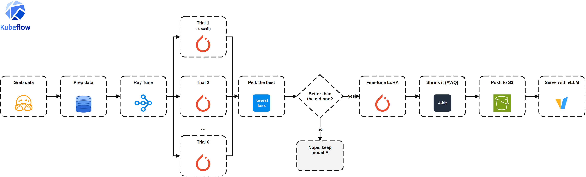

# LLM on EKS: Hyperparameter Tuning with Ray Tune

Hi there! 👋🏽 Quick recap before we start. In the [Kubeflow pipeline post](../pipeline_llm/README.md), we fine-tuned `Qwen2.5-1.5B-Instruct` with LoRA, quantized it with AWQ, and pushed it to S3. In the [previous post](./README-rollout.md), vLLM started serving that model from S3 as `qwen-lora`, and switching to a new model became a Git commit that Argo CD rolls out with no downtime. Let's call the model that's serving now model A.

The chatbot from the previous post is an assistant for AWS Community Day Jakarta 2026, where this series is turning into a talk. It answers questions about the agenda, rooms and speakers from a small knowledge base built from the event page.

But one thing bugged me: the LoRA settings behind model A were a guess. So in this post, we'll set up a way to measure them. The pipeline searches for better settings with Ray Tune, and when one of them wins, the new model (model B) gets rolled out. The full architecture is in the [previous post](./README-rollout.md#architecture).

## TL;DR

- Before tuning anything, we check if the event chatbot needs fine-tuning at all.
- A new `tune_hyperparams` step runs Ray Tune inside a single GPU pod, searching LoRA `r`, `lora_alpha`, and `learning_rate` on a held-out eval split.
- ASHA stops weak trials after one epoch, so 6 trials cost a lot less than 6 full trainings.
- The hand-picked settings from the pipeline post run as one of the trials (the baseline), so we can see where that guess ranks.
- If the best config doesn't beat the baseline, the pipeline stops and the served model stays as it is.
- Each run writes its model to its own S3 prefix. Rolling it out is the same Git commit as in the previous post.
- The pipeline hasn't run yet. What we measured so far: model A scores 6/15 with the whole knowledge base in the prompt, and 11/15 when the prompt gets the matching lines instead.

## Why Tune at All?

In the pipeline post, I picked the LoRA settings (`r=16`, `alpha=32`, `lr=5e-5`) because they're common defaults, not because I measured them. The pipeline trained on all 200 examples with no held-out set. The one signal we had was training loss, and it was going down when the epoch ended. That tells us the model was learning, not that these settings were good. And `5e-5` is on the low side for LoRA, most setups use something between `1e-4` and `2e-4`.

So the problem isn't that the first model is bad. We didn't measure it. In this post we hold out 20% of the data, try several LoRA configs under the same conditions, and keep the one with the lowest eval loss. The old defaults run as one of the trials. If they win, that's a real answer too: we'd know they're good instead of guessing.

## Does the Chatbot Need Fine-Tuning at All?

Tuning answers "which LoRA config is best?". But there's a question before that: "does LoRA beat the base model at all?". If it doesn't, we're tuning something we don't need.

For our event chatbot, my guess is no. People ask about facts: times, rooms, speakers. Facts go in the prompt, not in the weights. The whole event knowledge base (`src/knowledge_base.md`, generated from the event API by `src/build_kb.py`) is around 2k tokens. That fits in `max_model_len` 4096, so `Qwen2.5-1.5B-Instruct` can read it from the system prompt without a retrieval index. Fine-tuning changes how the model answers, not what it knows. And an agenda baked into the weights goes stale once the schedule changes.

Eval loss isn't chatbot quality either. A lower loss doesn't mean the model gets "what time is the LLM talk?" right.

### What Fine-Tuning Could Teach

The knowledge base goes into every request, so training has to look the same: context in the prompt, answer taken from it. The goal isn't to memorize the agenda. It's to teach the behavior around it: find the answer in the context, and say "I don't know" when it isn't there. That second part is where a 1.5B model tends to slip and make up a time or a speaker.

**Dataset, generated from `src/knowledge_base.md` with templates (no LLM in the loop):**

- Each session gives a few questions, in Indonesian and English: when is X, which room is X in, who presents X.
- Each example's context is a mini knowledge base: the line with the answer plus ~8 random lines around it. That keeps examples around 300 tokens instead of 2k, which matters on a T4.
- Unanswerable examples: the same question with the answer line removed from the context, and the target reply is "not in the event info, check jakarta.awscommunity.id/comday". Plus questions the event page doesn't cover (parking, wifi, dress code).
- Split by session, not by row. Sessions in the test set don't show up in training, so the test score measures lookup, not memory.

**Scoring, automatic:**

- Answerable: correct if the reply contains the right time, room or name.
- Unanswerable: correct if the reply says it doesn't know and contains no invented time or name.

**Three models, one test set:**

| Model | Question it answers |
|---|---|
| Base Qwen + knowledge base | the no-training baseline |
| LoRA, old settings (`r=16`, `alpha=32`, `lr=5e-5`) | does fine-tuning help? |
| LoRA, Ray Tune's best config | does tuning help on top of that? |

Ray Tune ranks trials with `eval_loss` because it's cheap per trial, but the rollout decision uses test accuracy. And we run Ray Tune when the old-settings LoRA beats the base model. If it doesn't, that's the finding: for a chatbot about facts, a knowledge base in the prompt is enough, and fine-tuning or tuning doesn't add anything.

My guess: the base model can handle simple lookups like "what time is X?". If there's a gap, it shows up in "I don't know" answers and in multi-step questions like "what's on the Main Stage after lunch?".

**Has to change before this runs:**

- The dataset. `mlabonne/guanaco-llama2-1k` uses the Llama-2 `[INST]` template; the new one is built with Qwen's chat template.
- Loss masking. `finetune_lora` and `tune_hyperparams` set `labels = input_ids`, so the loss covers the prompt too. With a long context in the prompt, most of that loss is about copying the knowledge base. Prompt tokens need to be masked (`-100`) so the loss counts the answer and nothing else.

## What Changed in the Pipeline

The pipeline grabs 200 examples, then Ray Tune tries 6 LoRA configs, and one of them is the old config from the pipeline post. The best config has to beat that old one. If it doesn't, the pipeline stops and model A stays. If it does, we train with the winner, shrink it with AWQ, push it to S3, and serve it with vLLM. The diagram shows the trials side by side, but on our single T4 they run one at a time.



> Click the image to zoom in.

### Ray Tune in One Pod

We have a RayCluster in the cluster, but it's busy serving vLLM. Its GPU workers hold the model, and taking one away for training means one replica less for users. So `tune_hyperparams` starts its own Ray inside the pipeline pod, on the one T4 that pod gets:

```python
ray.init(num_gpus=1 if use_gpu else 0, include_dashboard=False)
```

When the step ends, Ray goes away with the pod. No second RayCluster to run or pay for.

The search space covers three settings:

```python
param_space={
    "lora_r": tune.choice([8, 16, 32]),
    "lora_alpha": tune.choice([16, 32, 64]),
    "learning_rate": tune.loguniform(5e-5, 5e-4),
},
```

Each trial is a short LoRA training on 80% of the data, evaluated on the other 20% at the end of every epoch. It reports `eval_loss` to Ray Tune after each epoch, and that's what ASHA works with. ASHA (`grace_period=1`, `reduction_factor=2`) compares trials after the first epoch and stops the weak ones, so they don't burn GPU time on epochs 2 and 3. A config that keeps winning runs up to `max_t`, 3 epochs.

Two settings are there because of the single T4:

- `max_concurrent_trials=1`: one GPU, one trial at a time.
- `reuse_actors=False`: every trial gets a fresh worker process, so the GPU memory of the last trial is freed when it ends. We hit memory left behind in one process before, when merging Llama in the pipeline post.

### The Baseline Gate

The old settings (`r=16`, `alpha=32`, `lr=5e-5`) go in as the first trial:

```python
search_alg=BasicVariantGenerator(points_to_evaluate=[baseline]),
```

So the baseline runs under the same conditions as the others, and the trials table shows where it ranks. The step returns the best config plus `beats_baseline`, which is false when the baseline itself has the lowest eval loss.

The pipeline uses that flag to decide whether to train at all:

```python
with dsl.If(search.outputs["beats_baseline"] == True):
    train = finetune_lora(..., lora_r=search.outputs["lora_r"], ...)
    quant = quantize_and_upload(model_in=train.outputs["model_out"], ...)
```

If the baseline wins, model A was trained with the best config we found, and training it again changes nothing. The pipeline skips the full training and AWQ, which are the two longest GPU steps, and model A stays.

## Rolling Out the Winner

When a config wins, `quantize_and_upload` writes model B to `pipeline-output/<run-id>`. The pipeline stops there, it has no access to the cluster. Rolling out model B is the commit from the [previous post](./README-rollout.md#rolling-out-model-b):

```bash
sed -i 's|^modelPrefix:.*|modelPrefix: pipeline-output/<run-id>|' manifests/vllm/values.yaml
git add manifests/vllm/values.yaml
git commit -m "feat(new model): serve <run-id>"
git push
```

Argo CD syncs it, KubeRay builds a new cluster with model B, and model A serves until B is ready.

## What We Know So Far

I haven't run this pipeline yet, so there's no trials table and no model B in this post. What we do have is the baseline the run has to beat: model A with the knowledge base, measured on the AWS Community Day cluster with `tests/eval_kb.py` (`just eval`):

| Setup | Score |
|---|---|
| Model A, whole knowledge base in the prompt | 6/15 |
| Model A, keyword retrieval (the prompt gets the matching lines) | 11/15 |

The misses aren't random. Questions about one line work: where and when the event is, which room a talk is in when you give its full title. Questions where the model has to scan many lines fail: "who speaks from AWS?", "what's on the Main Stage after lunch?". A section that groups speakers by company turned the first one into a one-line lookup, and the model got it right 3 times out of 3.

That changes my guess from the start of this post. The biggest gap so far is how much context the 1.5B model gets, not its weights. Sending fewer, better lines (retrieval) gained more than any LoRA setting is likely to.

## What's Next

The pipeline in this post is ready to run, but it needs two changes first (see [What Fine-Tuning Could Teach](#what-fine-tuning-could-teach)):

1. A dataset built from the knowledge base, in place of `guanaco-llama2-1k`.
2. Loss masking, so training counts the answer and not the prompt.

Then one run answers three questions with the same test set: does LoRA beat base Qwen with the knowledge base, does tuning beat the old settings, and does either one beat retrieval. I'll add the results here once that run happens.

## Deploy

```bash
cd hypertuning_llm
cp .env.example .env    # account, region, admin user, bucket, GITOPS_REPO_URL, GITOPS_REVISION
just deploy             # refuses to run with uncommitted changes in the folder
just kubeconfig
just compile            # writes hypertuning_llm/kubeflow/pipelines/finetune_pipeline.yaml
just kfp-ui             # KFP at localhost:8080
```

In the KFP UI, upload `finetune_pipeline.yaml` and start a run with `bucket_name` set to your bucket. `num_trials` (6) and `tune_max_epochs` (3) control how much GPU time the search gets. The trials table shows up as the `trials_report` artifact of the `tune-hyperparams` step.

For the chatbot and the rollout, follow the [previous post](./README-rollout.md#deploy), and clean up the same way.

## Conclusion

Ray Tune fits into the pipeline as one more step, without touching the RayCluster that serves users. It runs in the training pod, ASHA cuts the weak trials after one epoch, and the old settings compete as one of the trials. When they win, the pipeline skips the training and keeps model A.

The bigger lesson came before any tuning: measure the thing you want to improve. For our event chatbot, the numbers so far point at the prompt, not the weights. Tuning is ready for the day a dataset says the weights matter.
